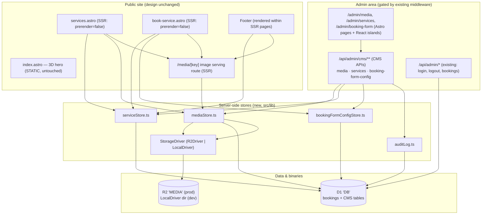
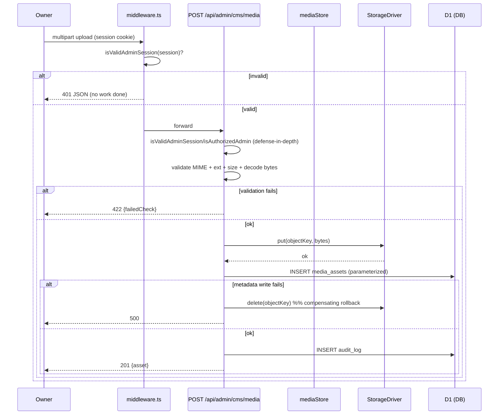
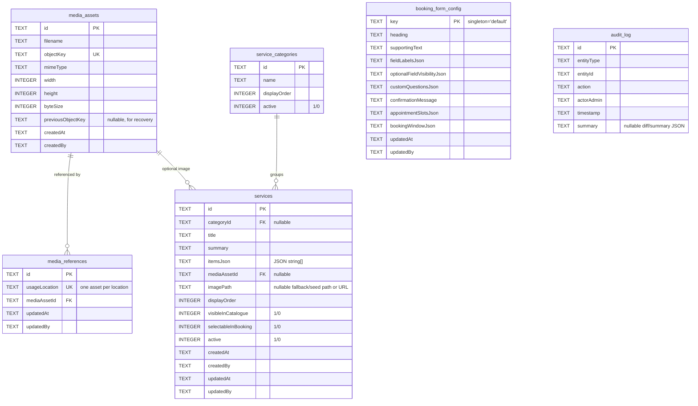
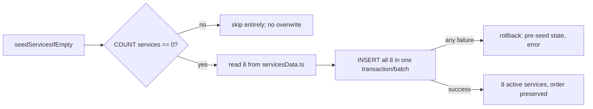
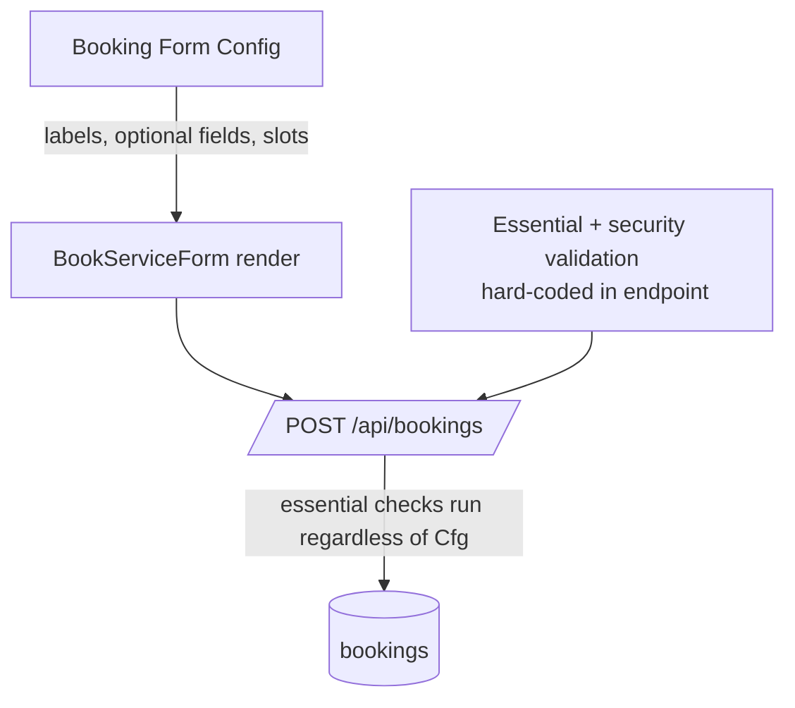

# Design Document — Admin CMS

## Overview

The Admin CMS extends the **existing** Grand Motors admin panel into a lightweight,
owner-operated content management surface for three content domains: **Media** (images),
**Services** (the catalogue), and the **Booking Form** (wording, fields, availability).
It is explicitly *not* a page builder and does *not* redesign the public site or touch the
3D cinematic hero.

The design layers onto what is already built and reuses it verbatim:

- **Auth / gating stays as-is.** `src/middleware.ts` already gates `/admin/*` (redirect to
  `/admin/login`) and `/api/admin/*` (401 JSON), exempting the login/logout endpoints. All new
  CMS pages live under `/admin/*` and all new CMS APIs under `/api/admin/cms/**`, so they inherit
  the existing gate with **zero middleware changes**. `src/lib/serverAuth.ts`
  (`isValidAdminSession`, `isAuthorizedAdmin`, `verifyAdminPassword`, `timingSafeEqual`,
  `ADMIN_SESSION_MAX_AGE_MS`) is reused unchanged for defense-in-depth in each handler.
- **Storage stays within existing infrastructure.** D1 (`DB`) holds all *data* (service config,
  booking-form config, media metadata, media references, audit log). A new **R2** binding
  (`MEDIA`) holds image *binaries* in production; a **LocalDriver** backs local dev under
  Wrangler/Miniflare without a Cloudflare account. No binaries are ever stored in D1.
- **The public site keeps its design.** The eight services, the services-page hero/CTA, the
  footer image, and the booking-form wording start as *exact copies* of today's hardcoded values
  (seeded into D1) so the first render after enabling the CMS is pixel-identical. Only the
  *source* of that content moves from hardcoded modules to D1; the markup, layout, Tailwind
  classes, and components are untouched.
- **The 3D hero is out of scope.** `src/components/ExperienceRoot.tsx`, `HUD.tsx`,
  `src/experience/**`, and `public/{models,textures,hdri,sequences,decoders}` are never read,
  written, or enumerated by the CMS. The home page (`index.astro`) that mounts the hero stays
  statically prerendered and untouched. The CMS exposes a **fixed** set of Usage Locations that
  deliberately excludes every hero-bundled asset.

The primary persona is the **Owner**: a non-technical admin already authenticated through the
existing login flow.

### Requirement coverage map

| Area | Requirements |
| --- | --- |
| Media Library (upload/browse/replace/delete/assign) | 1, 2, 3, 4, 5 |
| Service Manager (seed/manage/order/visibility/single source) | 6, 7, 8, 9 |
| Booking Form Customizer (content/availability/essential-field protection) | 10, 11, 12 |
| Public rendering + fallbacks + hero preservation | 13, 14, 15 |
| Storage architecture (D1/R2 + local dev) | 16, 17 |
| Security & reliability (auth, parameterized SQL, booking security, audit) | 18, 19, 20 |
| Guardrails (no deploy/provisioning, preserve site, migrations, verification) | 21, 22, 23, 24 |

---

## Architecture

### System layering

The CMS sits as a new slice inside the current app. Nothing below the dashed line changes
behaviourally except that the public read path now sources content from D1 instead of hardcoded
modules.



### Static vs SSR (hybrid) matrix

Astro `output: 'static'` with the Cloudflare adapter; a route becomes SSR only when it declares
`export const prerender = false`. The CMS adds SSR only where a page must read D1 at request time.

| Route | Mode today | Mode after CMS | Reason |
| --- | --- | --- | --- |
| `index.astro` (3D hero home) | static | **static (unchanged)** | Hero is bundled; must not read D1 or change. Req 15, 22. |
| `services.astro` | static | **SSR (`prerender = false`)** | Must read Service Config + Usage-Location media from D1. Req 9.2, 13.2. |
| `book-service.astro` | static | **SSR (`prerender = false`)** | Must read Service Config options + Booking Form Config. Req 9.3, 13.3. |
| `about.astro`, `contact.astro` | static | **SSR only if** they render a CMS Usage Location image | Req 13.1. If they only render fixed media, they can stay static and pull images via `/media/[key]` at runtime. |
| `/api/admin/cms/**` | n/a | **SSR (`prerender = false`)** | API routes. |
| `/media/[key]` | n/a | **SSR (`prerender = false`)** | Serves binaries via the active driver. |

The Footer is a component rendered *inside* `services.astro`/`book-service.astro` (and other
pages); it receives its service links and footer image as props from the SSR frontmatter rather
than importing the hardcoded list. Pages that remain static receive a seeded/default footer
snapshot so they never need D1 at build time.

### Request flow — media upload (representative mutation)



---

## Components and Interfaces

### New server modules (`src/lib/`)

| Module | Responsibility |
| --- | --- |
| `storage/StorageDriver.ts` | Driver interface + `resolveStorageDriver(env)` factory (R2 if `env.MEDIA` present, else Local). |
| `storage/R2Driver.ts` | R2-backed `put/get/delete/getUrl` against `env.MEDIA`. |
| `storage/LocalDriver.ts` | Filesystem/in-namespace dev driver (see Storage section). |
| `mediaStore.ts` | Media asset + reference CRUD over D1; orchestrates driver + metadata atomically; image validation (`validateImageUpload`). |
| `serviceStore.ts` | Authoritative read/write of service categories + services; seeding; public read shape. |
| `bookingFormConfigStore.ts` | Read/write Booking Form Config; essential-field protection; typed config shape + defaults. |
| `usageLocations.ts` | The fixed, system-defined Usage Location registry (enum + metadata). |
| `auditLog.ts` | Append audit rows; capture actor/action/time/diff. |
| `cmsAuth.ts` (thin) | `requireAdmin(context)` helper wrapping `isValidAdminSession`/`isAuthorizedAdmin` for handlers. |

### New admin pages + islands

- Pages: `src/pages/admin/media.astro`, `src/pages/admin/services.astro`,
  `src/pages/admin/booking-form.astro` — each uses the existing `AdminLayout.astro`.
- React islands (under `src/components/admin/`): `MediaLibrary.tsx`, `ServiceManager.tsx`,
  `BookingFormEditor.tsx`. They talk only to `/api/admin/cms/**` and mirror the existing
  `AdminDashboard.tsx` patterns (fetch + optimistic UI + error surfacing).

### Frontend icon mapping (presentational, stays in frontend)

The React `icon` component on `ServiceCategory` is presentational and cannot live in D1. It stays
in the frontend as a lookup keyed by service **id**:

```ts
// src/components/site/serviceIcons.ts
import { EngineIcon, BrakeIcon, /* ... */ WrenchIcon } from './Icons';
export const SERVICE_ICONS: Record<string, IconType> = {
  'engine-diagnostics': EngineIcon, brakes: BrakeIcon, /* ...the 8 ids... */
};
export const DEFAULT_SERVICE_ICON: IconType = WrenchIcon; // safe default for new services
export const iconForService = (id: string): IconType => SERVICE_ICONS[id] ?? DEFAULT_SERVICE_ICON;
```

D1 stores data only; the public render joins the D1 service row with `iconForService(id)`.

---

## Data Models

### Storage separation (Req 16, 1.4)

- **D1 (`DB`)**: service config, booking-form config, media **metadata**, media references, audit log.
- **Storage Driver (R2 `MEDIA` / Local)**: image **binaries** only, addressed by Object Key.
- **Never** store binaries in D1.

### Migrations strategy (Req 23)

A top-level **`/migrations`** folder (the dist `wrangler.json` already expects
`migrations_dir "../../migrations"`) holds ordered, immutable `.sql` files. Each schema change is
a new file; existing files are never edited destructively. `schema.sql` is retained for reference
but migrations become the source of truth.

```
/migrations
  0001_baseline_bookings.sql     -- CREATE TABLE IF NOT EXISTS bookings (...)  (preserves existing data)
  0002_media.sql                 -- media_assets, media_references (+ indexes)
  0003_services.sql              -- service_categories, services (+ indexes)
  0004_booking_form_config.sql   -- booking_form_config
  0005_audit_log.sql             -- audit_log
```

- `0001` reproduces the **current** `bookings` table verbatim using `CREATE TABLE IF NOT EXISTS`,
  so applying it against an existing DB is a no-op and **no booking data is lost** (Req 23.3).
- Later migrations only *add* tables/indexes; they never drop or rewrite `bookings`.
- Before any schema change, the implementer inspects the live schema
  (`PRAGMA table_info` / `sqlite_master`) per Req 23.1.

### Entity-relationship model



### Table definitions and access patterns

**`media_assets`** — `id TEXT PK`, `objectKey TEXT NOT NULL UNIQUE`, `filename`, `mimeType`,
`width INTEGER`, `height INTEGER`, `byteSize INTEGER`, `previousObjectKey TEXT` (nullable; retained
on replace for recovery, Req 3.3/20.2), `createdAt`, `createdBy`. Index on `filename` for search.

**`media_references`** — `id TEXT PK`, `usageLocation TEXT NOT NULL UNIQUE`,
`mediaAssetId TEXT NOT NULL REFERENCES media_assets(id)`, `updatedAt`, `updatedBy`. The
`UNIQUE(usageLocation)` constraint enforces *exactly one* asset per location (Req 5.2/5.3).
Index on `mediaAssetId` to answer "is this asset in use?" cheaply (Req 2.4/4.2).

**`service_categories`** — `id TEXT PK`, `name TEXT NOT NULL`, `displayOrder INTEGER NOT NULL`,
`active INTEGER NOT NULL DEFAULT 1`.

**`services`** — `id TEXT PK`, `categoryId TEXT REFERENCES service_categories(id)` (nullable;
the current 8 are standalone categories, so seed keeps them category-less or self-categorised),
`title TEXT NOT NULL`, `summary TEXT`, `itemsJson TEXT NOT NULL DEFAULT '[]'` (ordered JSON array
of strings), `mediaAssetId TEXT REFERENCES media_assets(id)` (nullable), `imagePath TEXT`
(nullable; holds the seed path/URL and acts as fallback when no `mediaAssetId`),
`displayOrder INTEGER NOT NULL`, `visibleInCatalogue INTEGER NOT NULL DEFAULT 1`,
`selectableInBooking INTEGER NOT NULL DEFAULT 1`, `active INTEGER NOT NULL DEFAULT 1`,
plus `createdAt/By`, `updatedAt/By`. Index on `(active, visibleInCatalogue, displayOrder)` for the
public catalogue read; index on `(active, selectableInBooking, displayOrder)` for booking options.

**`booking_form_config`** — singleton keyed row (`key TEXT PK` with the only row `'default'`).
Structured fields are stored as JSON strings (`fieldLabelsJson`, `optionalFieldVisibilityJson`,
`customQuestionsJson`, `appointmentSlotsJson`, `bookingWindowJson`) plus scalar `heading`,
`supportingText`, `confirmationMessage`, and `updatedAt/By`.

**`audit_log`** — `id TEXT PK`, `entityType`, `entityId`, `action`, `actorAdmin`, `timestamp`,
`summary` (nullable JSON diff). Append-only.

**Access patterns**: every statement is parameterized (`?` bind) exactly like the existing
booking endpoints (Req 19.1). Typical reads:

- Public catalogue: `SELECT ... FROM services WHERE active=1 AND visibleInCatalogue=1 ORDER BY displayOrder ASC`.
- Booking options: `SELECT ... FROM services WHERE active=1 AND selectableInBooking=1 ORDER BY displayOrder ASC`.
- In-use check: `SELECT usageLocation FROM media_references WHERE mediaAssetId=?` (plus any
  `services.mediaAssetId=?`).
- Resolve a Usage Location image: `SELECT a.objectKey, a.mimeType FROM media_references r JOIN media_assets a ON a.id=r.mediaAssetId WHERE r.usageLocation=?`.

### TypeScript shapes (public read contract)

```ts
export interface ServiceView {
  id: string; title: string; summary: string; items: string[];
  imageUrl: string;        // /media/<key> if assigned, else imagePath, else placeholder
  imageAlt: string;
  visibleInCatalogue: boolean; selectableInBooking: boolean; active: boolean;
  displayOrder: number;
}
export interface BookingFormConfigView {
  heading: string; supportingText: string;
  fieldLabels: Record<string, string>;
  optionalFieldVisibility: Record<string, boolean>;
  customQuestions: Array<{ id: string; label: string; required: false }>;
  confirmationMessage: string;
  appointmentSlots: string[];
  bookingWindow: { minLeadDays?: number; maxAdvanceDays?: number };
}
```

### Env additions

`src/env.d.ts` gains `MEDIA?: R2Bucket` on `Env`; `wrangler.json`/`wrangler.toml` gains an R2
binding named `MEDIA` for production. Local dev needs no binding — the factory falls back to the
LocalDriver when `env.MEDIA` is absent (Req 17).
---

## Storage Driver

### Interface

```ts
// src/lib/storage/StorageDriver.ts
export interface StorageDriver {
  /** Store bytes under an object key. Overwrites only if the key is reused (keys are unique). */
  put(objectKey: string, bytes: Uint8Array, meta: { mimeType: string }): Promise<void>;
  /** Fetch bytes + content type for serving, or null when absent (triggers Safe Fallback). */
  get(objectKey: string): Promise<{ bytes: Uint8Array; mimeType: string } | null>;
  /** Remove bytes. Idempotent: deleting a missing key is a no-op success. */
  delete(objectKey: string): Promise<void>;
  /** Stable public URL for an object key, driver-independent (always the /media route). */
  getUrl(objectKey: string): string;
}

export function resolveStorageDriver(env: Env): StorageDriver {
  return env.MEDIA ? new R2Driver(env.MEDIA) : new LocalDriver();
}
```

`getUrl` returns the **same shape regardless of driver** — `/media/<objectKey>` — so the public
site never cares which driver is active (Req 17.3). The `/media/[key]` SSR route calls
`driver.get(key)` and streams the bytes with the stored `mimeType`.

### R2Driver (production)

Wraps `env.MEDIA` (an `R2Bucket`): `put` → `MEDIA.put(key, bytes, { httpMetadata })`, `get` →
`MEDIA.get(key)`, `delete` → `MEDIA.delete(key)`. No remote provisioning is performed by code;
the binding is declared in config and bound by the platform (Req 21.2).

### LocalDriver (development, no CF account)

Backs storage without R2 so the CMS runs under `wrangler dev`/Miniflare offline (Req 17.1/17.2):

- Persists binaries under a gitignored dev directory (e.g. `.cms-media/<objectKey>`) via Node's
  `fs` (available in the dev/Miniflare Node compat context) — or, as an alternative that keeps
  parity with Miniflare's simulated bindings, a Miniflare-simulated R2/KV namespace. Either way,
  `get`/`put`/`delete` operate purely on the **Object Key**, so switching drivers requires no data
  reshaping (Req 17.3).
- `getUrl` returns `/media/<objectKey>` identically to R2Driver, so the served URL is stable
  across environments.

### Object Key generation

```ts
// collision-resistant; sanitized original name is cosmetic only
objectKey = `${yyyymmdd}/${crypto.randomUUID()}-${sanitize(originalName)}`;
```

A fresh UUID per store (including per replacement) guarantees uniqueness, so a replace never
overwrites the previous binary — enabling recovery via `previousObjectKey` (Req 3.3). `sanitize`
strips path separators and unsafe characters; uniqueness never depends on the original name.

---

## API Endpoint Contracts

All CMS endpoints live under `/api/admin/cms/**`, declare `export const prerender = false`, and are
gated by the existing middleware. Every handler **also** performs an in-handler check
(`requireAdmin` → `isValidAdminSession(session)` for browser sessions, with
`isAuthorizedAdmin(request, env)` accepted for tooling) as defense-in-depth (Req 18.1/18.2). All
SQL is parameterized (Req 19.1). All mutations append an `audit_log` row (Req 20.1).

Standard error envelope: `{ "error": string, "failedCheck"?: "mime"|"extension"|"size"|"content" }`.
Status codes: `200` ok, `201` created, `400` malformed request, `401` unauthenticated,
`409` conflict (e.g. in-use delete), `422` validation failure, `500` server error,
`503` binding unavailable.

### Media

| Method & path | Purpose | Request | Success | Notes |
| --- | --- | --- | --- | --- |
| `POST /api/admin/cms/media` | Upload | `multipart/form-data` file | `201 {asset}` | Validate mime/ext/size/decode **before** storing (Req 1.1/1.2); store binary then metadata with compensating rollback on partial failure (Req 1.7). |
| `GET /api/admin/cms/media?q=` | List/search | query `q` | `200 {assets:[{...,usageLocations:[]}]}` | Case-insensitive substring over filename + assigned location name (Req 2.2); empty + `matched:false` on no hits (Req 2.3). |
| `POST /api/admin/cms/media/:id/replace` | Replace | `multipart/form-data` file | `200 {asset}` | Same validation as upload; new unique key; set `previousObjectKey`; references follow automatically because they point to the asset id (Req 3.2); on failure leave everything unchanged (Req 3.4). |
| `DELETE /api/admin/cms/media/:id` | Delete | `{confirmFilename}` | `200 {deleted:true}` | Require confirmation naming the asset (Req 4.1); if in use → `409 {usageLocations:[...]}` and no deletion (Req 4.2); else remove binary + metadata together (Req 4.3). |
| `POST /api/admin/cms/media/assign` | Assign to location | `{usageLocation, mediaAssetId}` | `200 {reference}` | Reject unknown location → `400` (Req 5.4); upsert so the location references exactly one asset (Req 5.2/5.3). |
| `GET /api/admin/cms/usage-locations` | List fixed locations | — | `200 {locations:[...]}` | Fixed registry; hero assets excluded (Req 5.1/5.5). |

### Services

| Method & path | Purpose | Success | Notes |
| --- | --- | --- | --- |
| `GET /api/admin/cms/services` | List all (admin view, incl. inactive) | `200 {categories, services}` | — |
| `POST /api/admin/cms/services` | Create service/category | `201 {record}` | Non-empty name required else `422 {field:'name'}` (Req 7.1/7.5); displayOrder = after existing in grouping. |
| `PATCH /api/admin/cms/services/:id` | Edit name/summary/items/image | `200 {record}` | Retains id/order/flags on content edits (Req 7.2); image set by `mediaAssetId` (Req 7.4). |
| `POST /api/admin/cms/services/:id/deactivate` | Deactivate | `200 {record}` | Marks `active=0`, retains all fields (Req 7.3). |
| `POST /api/admin/cms/services/reorder` | Reorder | `200 {order}` | Persist contiguous unique ascending `displayOrder` (Req 8.1). |
| `POST /api/admin/cms/services/:id/visibility` | Toggle catalogue visibility | `200 {record}` | Req 8.2. |
| `POST /api/admin/cms/services/:id/selectability` | Toggle booking selectability | `200 {record}` | Req 8.3. |

### Booking Form Config

| Method & path | Purpose | Success | Notes |
| --- | --- | --- | --- |
| `GET /api/admin/cms/booking-form-config` | Read config | `200 {config}` | Returns defaults if unset. |
| `PUT /api/admin/cms/booking-form-config` | Update config | `200 {config}` | Persists heading/text/labels/optional-visibility/custom questions/confirmation/slots/window (Req 10, 11.1/11.2). **Rejects** removing an Essential Field or making it optional → `422` (Req 12.1). |

### Public read paths (no admin API exposed)

Public pages read D1 **server-side in `.astro` frontmatter** via the stores — there is **no public
admin API** (Req 14.3). Image bytes are served by a public SSR route:

| Method & path | Purpose | Notes |
| --- | --- | --- |
| `GET /media/[key]` | Serve a stored binary | `prerender=false`; `driver.get(key)`; `404` → Safe Fallback handled by caller/`` fallback. Read-only; no mutation; no metadata leak beyond bytes + content type. |

The public booking POST (`/api/bookings`) is unchanged in security posture and is *not* part of the
CMS admin surface.

---

## Service Config Source of Truth (Req 9)

`src/lib/serviceStore.ts` is the single authoritative loader/mutator:

```ts
export async function getPublicCatalogue(db: D1Database): Promise<ServiceView[]>; // active && visibleInCatalogue
export async function getBookingOptions(db: D1Database): Promise<ServiceView[]>;  // active && selectableInBooking
export async function seedServicesIfEmpty(db: D1Database): Promise<void>;          // idempotent
```

- **Consumers switch to the store**: `services.astro` (catalogue), `book-service.astro` + its
  `BookServiceForm.tsx` island, and `Footer.tsx` (`SERVICES.slice(0,6)` → first six from
  `getPublicCatalogue`). None of them import `servicesData.ts` for live rendering anymore
  (Req 9.4). The hardcoded `servicesData.ts` is retained **only** as the seed source.
- **Icons stay frontend-side** via `iconForService(id)` with `DEFAULT_SERVICE_ICON` for new
  services (D1 never stores a React component).
- **BookServiceForm gets its services as props** from the SSR `book-service.astro` frontmatter
  (which calls `getBookingOptions`). No second hardcoded list exists in the island. (If a future
  need arises for client-side refresh, a read-only `GET /api/services` public endpoint could be
  added, but the baseline passes props from SSR.)

### Idempotent seeding (Req 6)



- Seeds exactly the eight ids (`engine-diagnostics`, `brakes`, `tyres-alignment`, `ac-electrical`,
  `suspension-steering`, `general-service`, `body-paint`, `detailing-interior`) with identical
  title, summary, item list + ordering, image assignment (`imagePath` = the current Unsplash/`/images`
  path), and ascending `displayOrder` matching source order (Req 6.1/6.2).
- Per-id skip: if any id already exists, that id is not re-seeded and never overwritten
  (Req 6.3). Baseline uses the "count == 0" guard; the per-id check is additive insurance so
  partial pre-existing state still can't be clobbered.
- All eight land `active=1, visibleInCatalogue=1, selectableInBooking=1` (Req 6.4).
- Seeding is atomic via a D1 batch/transaction: all-or-nothing, so a mid-seed failure leaves the
  pre-seed state and returns an error (Req 6.5).
- Media References are seeded so each Usage Location renders its current image (Req 5.6) — the
  seed inserts a `media_references` row per location pointing at a seeded `media_assets` row that
  records the current `/images/...` path (or marks it a built-in path asset), so the first render
  is identical.

---

## Booking Form Config and Essential-Field Protection (Req 10, 11, 12)

- `BookServiceForm.tsx` renders heading, supporting text, field labels, helper text, optional-field
  visibility, custom questions, confirmation message, and appointment slots **from the config**
  passed as props (Req 10, 11.3). Service category/specific-service options come from
  `getBookingOptions` (Req 9.3).
- **Essential Fields are hard-coded as protected** in `bookingFormConfigStore.ts`:
  `ESSENTIAL_FIELDS = ['customerName','phoneNumber','vehicle','preferredDate','preferredTime']`.
  Any config update that tries to hide/remove an essential field or set it optional is rejected
  (`422`), and the field stays required (Req 12.1).
- **Backend validation stays authoritative and independent.** `POST /api/bookings` keeps its
  existing server-side validation (`PHONE_REGEX`, `EMAIL_REGEX`, `DATE_REGEX`, length bounds,
  duplicate check, unique `GM-` id) **unchanged**. Config may *add* field validation
  (Req 12.2) but can **never weaken or disable** the essential/security checks (Req 12.3/12.4).
  No payment processing and no auto-confirmation are introduced (Req 11.4/11.5).



---

## Public Rendering + Safe Fallbacks (Req 13, 14)

- **Rendering source**: SSR pages read D1 via the stores and render with the **existing** markup/
  components, preserving design and layout (Req 13.4/22.1).
- **Media fallback**: a Usage Location whose asset is missing/deleted, or a `/media/[key]` miss,
  renders a bundled placeholder image (`public/images/placeholder.*`) instead of a broken image
  (Req 14.1). The `` uses the resolved URL with the placeholder as the fallback source.
- **Content fallback**: if a store read fails (D1 error), the page renders last-known/default
  content (seed defaults for services; config defaults for the booking form) and keeps the rest of
  the page functional (Req 14.2). Stores expose `getXOrDefault` wrappers that catch and fall back.
- **No admin exposure**: public pages call stores directly (no admin API), and `/media/[key]` is
  read-only, so no admin-only CMS function is reachable by visitors (Req 14.3).
- **Hero untouched**: the home page and 3D experience modules are never read or modified; no Usage
  Location maps to a hero-bundled asset (Req 15).
---

## Correctness Properties

*Correctness properties express characteristics or behaviours that must hold true across all valid
executions of a system — essentially, a formal statement about what the system should do. They serve
as the bridge between human-readable specifications and machine-verifiable correctness guarantees.*

This section uses property-based testing because the CMS core is logic-heavy and input-varying: image
validation, storage-driver round trips, media-reference set logic, seeding idempotency, service
filtering/ordering, config round-tripping, and auth gating all admit meaningful "for all inputs"
statements. UI layout fidelity and infrastructure wiring are covered by example/snapshot/integration
tests instead (see Testing Strategy).

### Property 1: Admin session required for every CMS mutation and admin read

*For any* CMS mutation or admin-only read request lacking a valid authenticated admin session, the
CMS rejects the request (401) and performs no persistence or storage side effect (no D1 write, no
driver `put`/`delete`).

**Validates: Requirements 1.5, 2.5, 3.5, 4.5, 7.6, 10.6, 18.1, 18.2**

### Property 2: Image validation is valid-iff-all-four-checks-pass and identifies failures

*For any* candidate upload or replacement, the validator accepts it **iff** its MIME type is one of
jpeg/png/webp, the extension matches the MIME type, the size is within configured bounds, and the
bytes decode as a valid image of that type; on rejection it reports which of the four checks failed.

**Validates: Requirements 1.1, 1.2, 3.1, 18.3, 18.4**

### Property 3: Valid upload stores one binary under a unique key plus matching metadata

*For any* valid upload, the CMS stores the binary via the driver under a newly generated Object Key
unique across all stored assets, and persists exactly one metadata row recording filename, width,
height, byteSize, MIME type, and that Object Key — with no image bytes written to D1.

**Validates: Requirements 1.3, 1.4, 1.6, 16.1**

### Property 4: Binary and metadata are both-or-neither (atomicity)

*For any* upload or delete in which one of {binary write, metadata write} fails after the other
succeeds, the CMS removes the completed part, so the end state contains either both the binary and
its metadata or neither — never an orphan.

**Validates: Requirements 1.7, 4.3, 4.4**

### Property 5: Media Library listing exposes complete per-asset details

*For any* set of stored assets and references, the Media Library listing returns, for each asset,
its preview source, filename, pixel dimensions, byte size, and the complete set of Usage Locations
currently assigned to it.

**Validates: Requirements 2.1, 2.4**

### Property 6: Search is exactly case-insensitive substring over filename and location name

*For any* set of assets and any search term, the result set equals exactly those assets whose
filename or an assigned Usage Location name contains the term under case-insensitive substring
matching.

**Validates: Requirements 2.2**

### Property 7: Replace flips all references to the new binary atomically

*For any* asset with any number of Usage Location references, a successful replacement stores the
new binary under a new unique Object Key and causes every one of those references to resolve to the
new binary, with none still resolving to the old one.

**Validates: Requirements 3.2**

### Property 8: Replace retains recoverable previous state

*For any* successful replacement, the previous Object Key is retained (`previousObjectKey`) and the
previous binary remains retrievable, sufficient to restore the prior image.

**Validates: Requirements 3.3, 20.2**

### Property 9: Failed replacement leaves the asset and its references unchanged

*For any* replacement that fails during validation or storage, the asset's binary, metadata, and all
of its Usage Location references are identical to their pre-attempt state.

**Validates: Requirements 3.4**

### Property 10: Deletion requires a confirmation naming the asset

*For any* delete request whose confirmation value does not match the targeted asset's filename, the
CMS rejects the deletion and removes nothing.

**Validates: Requirements 4.1**

### Property 11: In-use assets cannot be deleted

*For any* asset with one or more active references, a delete request is blocked, returns the exact
set of referencing Usage Locations, and leaves the binary and metadata intact.

**Validates: Requirements 4.2**

### Property 12: A Usage Location references exactly one asset after any assign sequence

*For any* Usage Location in the fixed set and any sequence of assignments to it, the CMS stores
exactly one active reference, pointing at the most recently assigned asset.

**Validates: Requirements 5.2, 5.3**

### Property 13: Assignments to unknown locations are rejected

*For any* assignment whose target is not a member of the fixed Usage Location set, the CMS rejects
it and writes no reference.

**Validates: Requirements 5.4**

### Property 14: Seeding is idempotent and never overwrites or duplicates

*For any* pre-existing subset of the eight service ids with arbitrary field values, running seeding
leaves every already-present record byte-for-byte unchanged, creates no duplicate ids, and keeps the
service count at eight; running seeding any number of times has the same effect as running it once.

**Validates: Requirements 6.1, 6.3**

### Property 15: Seeding is all-or-nothing

*For any* failure injected before all eight services are persisted, the Service Config is left in its
exact pre-seed state with no partial records, and an error is returned.

**Validates: Requirements 6.5**

### Property 16: Create assigns a trailing display-order position

*For any* existing set of records in a grouping, creating a new record with a non-empty name assigns
it a display-order strictly greater than every existing record in that grouping.

**Validates: Requirements 7.1**

### Property 17: Content edits preserve identity, order, and flags

*For any* service, editing its name, summary, or item list persists those changes while leaving its
id, display-order, visibility flag, and selectability flag unchanged.

**Validates: Requirements 7.2**

### Property 18: Deactivation retains the record and all its fields

*For any* service or category, deactivation sets its active flag to false while retaining the record
and every other stored field unchanged (no deletion).

**Validates: Requirements 7.3**

### Property 19: Image assignment updates the service's media reference

*For any* service and any existing Media Asset, assigning that asset to the service updates the
service to reference exactly that asset.

**Validates: Requirements 7.4**

### Property 20: Empty or whitespace-only names are rejected

*For any* create or edit whose name is empty or whitespace-only, the CMS rejects the mutation,
persists no change, and returns an error identifying the name field.

**Validates: Requirements 7.5**

### Property 21: Reorder yields a contiguous unique ascending order matching the submission

*For any* submitted ordering of records, the persisted display-order positions form a contiguous,
unique, ascending sequence that reflects the submitted order.

**Validates: Requirements 8.1**

### Property 22: Visibility and selectability flags round-trip

*For any* service and any sequence of visibility/selectability toggles, the persisted flags equal the
last applied values.

**Validates: Requirements 8.2, 8.3**

### Property 23: Public surfaces include a service only when permitted, with deactivation dominating

*For any* set of services, the public catalogue contains exactly those with `active` and
`visibleInCatalogue` both enabled, and the booking options contain exactly those with `active` and
`selectableInBooking` both enabled; a deactivated service appears in neither surface regardless of
its other flags.

**Validates: Requirements 8.4, 8.5, 8.6, 9.2, 9.3, 9.5**

### Property 24: Booking Form Config round-trips

*For any* valid Booking Form Config edit (heading, supporting text, labels, helper text,
optional-field visibility, custom questions, confirmation message, appointment slots, booking
window), reading the config back yields the written values.

**Validates: Requirements 10.1, 10.2, 10.3, 10.4, 10.5, 11.1, 11.2, 13.3**

### Property 25: The booking form offers only configured appointment slots

*For any* active Booking Form Config, the slots offered by the rendered Book Service form equal the
appointment slots permitted by that config.

**Validates: Requirements 11.3**

### Property 26: Essential Fields cannot be removed or made optional via config

*For any* config update that attempts to remove an Essential Field or mark it optional, the CMS
rejects the change and the field remains required.

**Validates: Requirements 12.1**

### Property 27: Essential and security validation hold independently of any config

*For any* Booking Form Config (including adversarial ones) and any booking submission missing an
Essential Field or violating a security/format check, the booking endpoint rejects the submission
server-side; no config value can disable or bypass essential or security validation.

**Validates: Requirements 12.3, 12.4, 19.2**

### Property 28: A Usage Location renders its currently referenced asset

*For any* Usage Location with an active reference to an existing asset, the public render resolves to
that asset's stored binary (its `/media/<objectKey>` URL).

**Validates: Requirements 13.1, 13.2**

### Property 29: Missing media and failed content loads fall back safely

*For any* Usage Location whose asset is missing or deleted, the resolver yields the Safe Fallback
placeholder rather than a broken/empty source; and *for any* content-store read that fails, the
loader returns last-known/default content without throwing, keeping the page functional.

**Validates: Requirements 14.1, 14.2**

### Property 30: Storage round-trips by Object Key, driver-independently

*For any* Object Key and byte payload, `get(put(key, bytes)) == bytes` for the active driver,
`delete` is idempotent, and `get` of an absent key returns null — so a Media Asset is retrievable by
its stored Object Key regardless of whether the R2 or Local driver is active.

**Validates: Requirements 17.3**

### Property 31: All D1 access is parameterized

*For any* store operation, including inputs containing SQL metacharacters, the executed statement
uses bound placeholders for user-provided values (no string interpolation), so injection-style
inputs are stored/compared as literal data.

**Validates: Requirements 19.1**

### Property 32: Every content mutation records audit metadata

*For any* mutation of Service Config, Booking Form Config, or a Media Reference, the CMS appends
exactly one audit record capturing the acting admin, the action, and the time.

**Validates: Requirements 20.1**

---

## Error Handling

- **Validation errors** (image checks, empty names, out-of-bounds config, unknown usage location)
  return `422`/`400` with a specific message and, for image checks, `failedCheck` naming the failed
  dimension. Nothing is persisted (Req 1.2, 7.5, 5.4, 18.3).
- **Atomicity / compensation**: upload and delete wrap the two-step binary+metadata operation so a
  partial failure triggers a compensating action (delete the orphan binary, or abort the metadata
  insert), leaving a both-or-neither state (Req 1.7, 4.3, 4.4). Seeding uses a D1 batch so it is
  all-or-nothing (Req 6.5).
- **Conflict**: deleting an in-use asset returns `409` with the referencing locations (Req 4.2).
- **Binding unavailable**: missing `DB` returns `503` (mirrors existing booking endpoints); missing
  `MEDIA` is *not* an error — the factory falls back to the LocalDriver (Req 17.1).
- **Public fallback**: public pages never surface raw errors; store reads are wrapped in
  `getXOrDefault` that catches failures and returns defaults, and media URLs fall back to a bundled
  placeholder (Req 14.1, 14.2).
- **Auth**: unauthenticated requests get the existing `401` JSON (API) or redirect (pages); handlers
  additionally re-check the session (Req 18.1/18.2).

## Security

- **Authentication on every mutation**: middleware gate (unchanged) plus in-handler
  `isValidAdminSession`/`isAuthorizedAdmin` (reused verbatim) — defense in depth (Req 18.1, 19.3).
- **Parameterized SQL everywhere** via `db.prepare(...).bind(...)`, exactly like the existing
  booking endpoints — no interpolation of user input (Req 19.1).
- **Image safety**: MIME allow-list (jpeg/png/webp), extension-matches-MIME, size bounds, and actual
  byte decode before any storage; this rejects spoofed/oversized/corrupt files (Req 1.1, 18.4).
- **Booking security preserved**: the public booking GET keeps PII stripping for non-admins; the
  create/patch endpoints keep admin gating and all existing validation. The CMS never relaxes these
  (Req 12.3, 19.2).
- **No public admin surface**: public pages read via server-side stores; `/media/[key]` is read-only
  and leaks only image bytes + content type (Req 14.3).
- **Audit metadata** records who/what/when for content mutations (Req 20.1).
- **No deploy / no remote provisioning**: implementation touches only local config and code; it never
  runs a deploy or creates remote Cloudflare resources, and relies only on `DB`, the auto-provisioned
  `SESSION` KV, the new (declared, not provisioned) `MEDIA` binding, and the Local driver (Req 21).
- **Hero untouched**: no CMS module imports or writes `src/experience/**`, `ExperienceRoot.tsx`,
  `HUD.tsx`, or `public/{models,textures,hdri,sequences,decoders}`; no Usage Location maps to a hero
  asset (Req 15, 22.3).

## Testing Strategy

**Dual approach.** Property-based tests cover the universal logic properties above; example-based
unit tests cover specific scenarios, boundaries, and integration seams; the existing 67 tests are a
regression baseline that must stay green (Req 24.3).

**Property-based tests.**
- Library: **fast-check** with vitest (JS/TS ecosystem; do not hand-roll PBT).
- Minimum **100 iterations** per property.
- Each property test is tagged: `// Feature: admin-cms, Property {N}: {property text}`.
- Each of the 32 properties above is implemented by a **single** property-based test.
- D1 is mocked with an in-memory fake matching the `prepare/bind/all/run/batch` surface already used
  by the booking tests; sessions are mocked like the existing admin tests
  (`adminAuth.test.ts`/`adminApi.test.ts`). The **LocalDriver** is tested for real (Property 30);
  R2Driver is tested against a mock `R2Bucket`.
- Generators cover edge cases explicitly: empty/whitespace names; whitespace-only and unicode
  strings; mismatched MIME/extension; min/max/over-size files; SQL-metacharacter strings (Property
  31); arbitrary/adversarial booking configs (Property 27); random reference sets and assign
  sequences.

**Example-based / snapshot / integration tests (not PBT).**
- Fixed Usage Location registry and hero-exclusion (5.1, 5.5, 15.x) — structural assertions.
- Seeding fidelity (6.2, 6.4, 5.6) — deep-equal the eight seeded records to source and assert each
  location resolves to its current image.
- Factory selection (17.1) — `resolveStorageDriver` returns Local without `MEDIA`, R2 with it.
- Public markup/design preservation (13.4) — snapshot/structure checks that components and classes
  are unchanged.
- No-payment / no-auto-confirm (11.4, 11.5), no paid dependency (16.3) — structural/dependency
  checks.
- Baseline migration idempotency (23.x) — assert `0001` uses `CREATE TABLE IF NOT EXISTS` and that
  applying migrations against a DB with an existing booking row preserves that row and its data.
- Middleware/regression (19.3, 22.x) — new routes under `/api/admin/cms/**` return `401` without a
  session; the 67 existing tests pass unchanged.

**Verification cadence (Req 24).** After each implementation stage run `npm run check`, `npm run
build`, and `npm test`; fix any failure before proceeding; keep the 67 existing tests green and add
tests for new behaviour.

---

## Migration / Rollout Note (Stages A–G)

Implementation proceeds in verifiable stages; each ends with check/build/test (Req 24):

| Stage | Scope | Key requirements |
| --- | --- | --- |
| **A — Foundations** | Create `/migrations` (0001 baseline bookings + 0002–0005 CMS tables); add `MEDIA` to env/config; `usageLocations.ts` registry. | 16, 21, 23 |
| **B — Storage Driver** | `StorageDriver` interface, `R2Driver`, `LocalDriver`, factory, `/media/[key]` serving route. | 16, 17 |
| **C — Media Library** | `mediaStore.ts`, image validation, upload/list/replace/delete/assign APIs, `MediaLibrary.tsx`. | 1, 2, 3, 4, 5, 18, 20 |
| **D — Service Manager** | `serviceStore.ts`, idempotent seeding, services CRUD/reorder/toggle APIs, `ServiceManager.tsx`, `serviceIcons.ts`. | 6, 7, 8, 9, 20 |
| **E — Public read switch** | Make `services.astro`/`book-service.astro` SSR; route Footer/BookServiceForm through the stores; keep home/hero static. | 9, 13, 14, 15, 22 |
| **F — Booking Form Customizer** | `bookingFormConfigStore.ts`, essential-field protection, config GET/PUT API, `BookingFormEditor.tsx`, wire config into `BookServiceForm` while keeping backend validation authoritative. | 10, 11, 12 |
| **G — Hardening** | Audit log coverage, fallbacks, full property/unit suite, final check/build/test and regression pass. | 14, 19, 20, 24 |

No stage performs a deployment or provisions any remote Cloudflare resource, and no stage modifies
the 3D cinematic hero.
