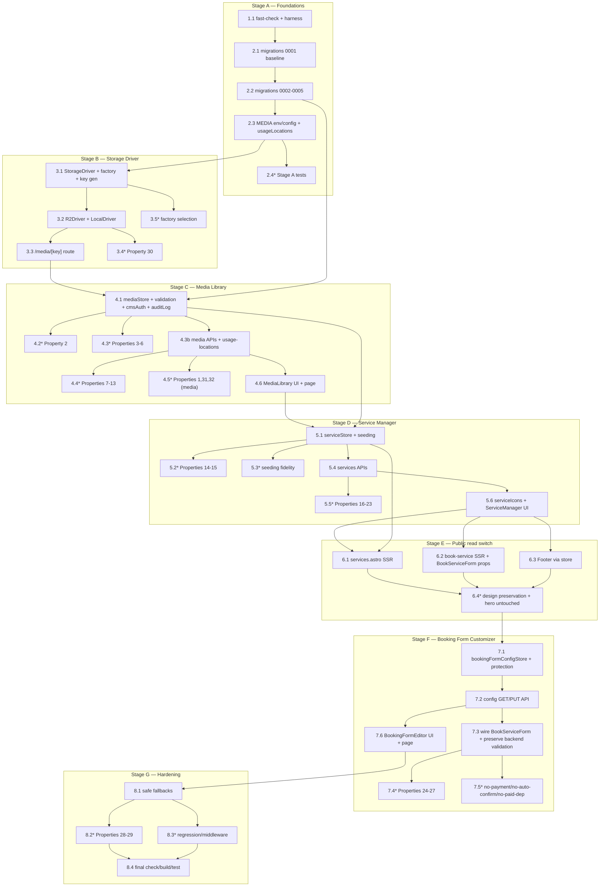

# Implementation Plan: Admin CMS

## Overview

This plan implements the Admin CMS in seven verifiable stages (A–G) that mirror the design's
Migration/Rollout matrix. Each stage builds on the previous one and ends green
(`npm run check`, `npm run build`, `npm test` all passing, including the 67 existing tests).

Implementation language is **TypeScript** throughout (the design is specified in TypeScript; no
pseudocode). Property-based tests use **fast-check + vitest** (one test per correctness property,
tagged `// Feature: admin-cms, Property N`), with a mock D1 mirroring the existing booking tests
(`prepare/bind/all/run/batch`) and mock sessions mirroring `adminAuth.test.ts`/`adminApi.test.ts`.
The **LocalDriver** is exercised for real; the R2Driver is tested against a mock `R2Bucket`.

Hard constraints restated here so each task is self-contained:
- Reuse existing admin auth/middleware (`src/middleware.ts`, `src/lib/serverAuth.ts`) — do NOT
  rebuild auth. New pages live under `/admin/*`, new APIs under `/api/admin/cms/**` so they inherit
  the existing gate; every handler still re-checks the session in-handler (defense in depth).
- NO deploy, NO remote Cloudflare provisioning. Local dev only via Wrangler/Miniflare. The `MEDIA`
  R2 binding is only *declared* in config for prod; dev falls back to LocalDriver.
- Binaries NEVER go in D1. D1 holds service config, booking-form config, media metadata, media
  references, and audit log only.
- Parameterized SQL everywhere (`db.prepare(...).bind(...)`), exactly like the booking endpoints.
- Do NOT touch the 3D hero (`ExperienceRoot.tsx`, `HUD.tsx`, `src/experience/**`,
  `public/{models,textures,hdri,sequences,decoders}`) or the static home page.
- Preserve existing booking API security (public PII-stripped reads, admin-gated writes) and the
  67 existing tests.

## Tasks

- [ ] 1. Stage A setup — add fast-check and prepare the test harness
  - [ ] 1.1 Add `fast-check` as a dev dependency and shared test helpers
    - Add `fast-check` to `devDependencies` in `package.json` (it is NOT currently present) and
      install it locally; keep vitest as the runner.
    - Create `src/lib/__testutils/mockD1.ts` — an in-memory fake D1 implementing the
      `prepare/bind/all/run/batch` surface used by the existing booking tests, reusable by all CMS
      tests; and `src/lib/__testutils/mockSession.ts` mirroring `adminAuth.test.ts`/`adminApi.test.ts`
      session mocking (valid/invalid/expired admin sessions).
    - Do not modify any existing test file; confirm the harness compiles.
    - _Requirements: 24.3, 18.1, 19.1_

- [ ] 2. Stage A — migrations, schema inspection, and env/config foundations
  - [ ] 2.1 Inspect current schema and create the ordered `/migrations` folder with the baseline
    - BEFORE any schema change, inspect the live `bookings` schema (`PRAGMA table_info(bookings)` /
      `sqlite_master`) and record it; reproduce it verbatim.
    - Create top-level `/migrations/0001_baseline_bookings.sql` using `CREATE TABLE IF NOT EXISTS
      bookings (...)` so applying it against an existing DB is a no-op and loses no booking data.
    - Keep `schema.sql` for reference only; migrations become the source of truth.
    - _Requirements: 23.1, 23.2, 23.3_

  - [ ] 2.2 Add CMS table migrations (0002–0005), additive only
    - `/migrations/0002_media.sql`: `media_assets` (`id` PK, `objectKey` UNIQUE NOT NULL, `filename`,
      `mimeType`, `width`, `height`, `byteSize`, `previousObjectKey` nullable, `createdAt`,
      `createdBy`; index on `filename`) and `media_references` (`id` PK, `usageLocation` UNIQUE NOT
      NULL, `mediaAssetId` FK NOT NULL, `updatedAt`, `updatedBy`; index on `mediaAssetId`).
    - `/migrations/0003_services.sql`: `service_categories` and `services` with the columns/indexes
      from the design (indexes on `(active, visibleInCatalogue, displayOrder)` and
      `(active, selectableInBooking, displayOrder)`).
    - `/migrations/0004_booking_form_config.sql`: singleton `booking_form_config` (`key` PK, JSON
      string columns + scalars + `updatedAt/By`).
    - `/migrations/0005_audit_log.sql`: append-only `audit_log`.
    - These migrations ONLY add tables/indexes; they never drop or rewrite `bookings`.
    - _Requirements: 16.1, 23.2, 23.3_

  - [ ] 2.3 Declare the `MEDIA` R2 binding (config only, no provisioning) and the usage-location registry
    - Add `MEDIA?: R2Bucket` to the `Env` interface in `src/env.d.ts`.
    - Declare an R2 binding named `MEDIA` in `wrangler.json` (prod); do NOT provision any remote
      resource. Confirm `migrations_dir` points at the migrations folder.
    - Create `src/lib/usageLocations.ts`: the fixed, system-defined Usage Location registry (enum +
      metadata) covering homepage sections, service page hero, footer/CTA, individual service
      images, about page, contact page, and designated content images — explicitly EXCLUDING every
      3D-hero-bundled asset.
    - _Requirements: 16.2, 21.1, 21.2, 21.3, 5.1, 5.5, 15.1, 15.2, 15.3_

  - [ ]* 2.4 Tests for Stage A foundations
    - Example test: `0001_baseline_bookings.sql` uses `CREATE TABLE IF NOT EXISTS`; applying the
      migrations against a mock DB containing an existing booking row preserves that row and data.
    - Structural test: `usageLocations.ts` registry is fixed (not runtime-extendable) and contains
      no hero-bundled asset location.
    - _Requirements: 23.3, 5.1, 5.5, 15.1_

  - [ ] 2.5 Checkpoint — Ensure all tests pass
    - Run `npm run check`, `npm run build`, `npm test`; keep the 67 existing tests green. Ask the
      user if questions arise.

- [ ] 3. Stage B — Storage Driver abstraction and media-serving route
  - [ ] 3.1 Define the StorageDriver interface, factory, and Object Key generation
    - Create `src/lib/storage/StorageDriver.ts` with the `StorageDriver` interface
      (`put/get/delete/getUrl`) and `resolveStorageDriver(env)` returning `R2Driver` when
      `env.MEDIA` exists, else `LocalDriver`. `getUrl(key)` returns `/media/<objectKey>` identically
      for all drivers. Include the Object Key generator (`${yyyymmdd}/${crypto.randomUUID()}-${sanitize(name)}`;
      `sanitize` strips path separators/unsafe chars; uniqueness never depends on the original name).
    - _Requirements: 16.2, 17.3_

  - [ ] 3.2 Implement R2Driver and LocalDriver
    - `src/lib/storage/R2Driver.ts`: wraps `env.MEDIA` — `put`→`MEDIA.put`, `get`→`MEDIA.get`,
      `delete`→`MEDIA.delete`; `delete` of a missing key is a no-op success; `get` of absent key
      returns null. No remote provisioning in code.
    - `src/lib/storage/LocalDriver.ts`: filesystem-backed dev driver persisting binaries under a
      gitignored dir (e.g. `.cms-media/<objectKey>`); operates purely on Object Key so switching
      drivers needs no data reshaping. Add `.cms-media/` to `.gitignore`.
    - _Requirements: 16.2, 17.1, 17.2, 17.3_

  - [ ] 3.3 Implement the public `/media/[key]` SSR serving route
    - Create `src/pages/media/[key].ts` with `export const prerender = false`; call
      `resolveStorageDriver(env).get(key)` and stream bytes with the stored `mimeType`; on miss
      return `404` so the caller/`` falls back to the placeholder. Read-only; no mutation; no
      metadata leak beyond bytes + content type.
    - _Requirements: 13.1, 14.1, 14.3, 17.3_

  - [ ]* 3.4 Property test — storage round-trip by Object Key (real LocalDriver + mock R2Bucket)
    - **Property 30: Storage round-trips by Object Key, driver-independently**
    - **Validates: Requirements 17.3** (tag `// Feature: admin-cms, Property 30`)
    - Assert `get(put(key, bytes)) == bytes`, `delete` idempotent, `get` of absent key → null, for
      both the real LocalDriver and a mock `R2Bucket`-backed R2Driver.

  - [ ]* 3.5 Example test — factory selection
    - `resolveStorageDriver` returns LocalDriver when `env.MEDIA` is absent and R2Driver when present.
    - _Requirements: 17.1_

  - [ ] 3.6 Checkpoint — Ensure all tests pass
    - Run `npm run check`, `npm run build`, `npm test`; keep the 67 existing tests green. Ask the
      user if questions arise.

- [ ] 4. Stage C — Media Library store, validation, APIs, and UI
  - [ ] 4.1 Implement image validation and the mediaStore CRUD over D1
    - Create `src/lib/mediaStore.ts` with `validateImageUpload(bytes, mime, ext, size)` enforcing
      MIME allow-list (jpeg/png/webp), extension-matches-MIME, size bounds, and actual byte decode,
      reporting which of the four checks failed. Implement asset + reference CRUD over D1 with
      parameterized SQL only, orchestrating driver + metadata atomically (compensating rollback on
      partial failure), recording filename/width/height/byteSize/mimeType/objectKey; never writing
      binaries to D1.
    - Create `src/lib/cmsAuth.ts` with `requireAdmin(context)` wrapping `isValidAdminSession` /
      `isAuthorizedAdmin` from `src/lib/serverAuth.ts` for in-handler defense in depth.
    - Create `src/lib/auditLog.ts` appending one audit row (actor/action/time/summary) per mutation.
    - _Requirements: 1.1, 1.2, 1.3, 1.4, 1.6, 1.7, 2.1, 2.2, 2.4, 18.3, 18.4, 19.1, 20.1_

  - [ ]* 4.2 Property test — image validation is valid-iff-all-four-checks-pass
    - **Property 2: Image validation is valid-iff-all-four-checks-pass and identifies failures**
    - **Validates: Requirements 1.1, 1.2, 3.1, 18.3, 18.4** (tag `Property 2`)
    - Generators: mismatched MIME/extension, min/max/over-size, corrupt bytes.

  - [ ]* 4.3 Property tests — upload storage, atomicity, listing, and search
    - **Property 3: Valid upload stores one binary under a unique key plus matching metadata** —
      **Validates: Requirements 1.3, 1.4, 1.6, 16.1** (tag `Property 3`).
    - **Property 4: Binary and metadata are both-or-neither (atomicity)** —
      **Validates: Requirements 1.7, 4.3, 4.4** (tag `Property 4`).
    - **Property 5: Media Library listing exposes complete per-asset details** —
      **Validates: Requirements 2.1, 2.4** (tag `Property 5`).
    - **Property 6: Search is exactly case-insensitive substring over filename and location name** —
      **Validates: Requirements 2.2** (tag `Property 6`).

  - [ ] 4.3b Implement upload / list / replace / delete / assign API endpoints and usage-locations endpoint
    - Create `src/pages/api/admin/cms/media.ts` (`POST` upload — validate before storing, store
      binary then metadata with compensating rollback; `GET` list/search — case-insensitive
      substring over filename + assigned location name, empty + `matched:false` on no hits).
    - Create `src/pages/api/admin/cms/media/[id]/replace.ts` (`POST` — same validation; new unique
      key; set `previousObjectKey`; references follow the asset id; leave everything unchanged on
      failure).
    - Create `src/pages/api/admin/cms/media/[id].ts` (`DELETE` — require `confirmFilename` naming
      the asset; `409 {usageLocations}` if in use; else remove binary + metadata together).
    - Create `src/pages/api/admin/cms/media/assign.ts` (`POST {usageLocation, mediaAssetId}` — reject
      unknown location `400`; upsert so a location references exactly one asset).
    - Create `src/pages/api/admin/cms/usage-locations.ts` (`GET` — fixed registry, hero excluded).
    - All routes `export const prerender = false`, call `requireAdmin` in-handler, use parameterized
      SQL, and append audit rows on mutation.
    - _Requirements: 1.1, 1.3, 1.5, 1.7, 2.1, 2.2, 2.3, 3.1, 3.2, 3.3, 3.4, 3.5, 4.1, 4.2, 4.3, 4.4, 4.5, 5.1, 5.2, 5.3, 5.4, 5.5, 18.1, 18.2, 19.1, 20.1_

  - [ ]* 4.4 Property tests — replace, delete, and assign semantics
    - **Property 7: Replace flips all references to the new binary atomically** — **Validates: 3.2** (tag `Property 7`).
    - **Property 8: Replace retains recoverable previous state** — **Validates: 3.3, 20.2** (tag `Property 8`).
    - **Property 9: Failed replacement leaves the asset and its references unchanged** — **Validates: 3.4** (tag `Property 9`).
    - **Property 10: Deletion requires a confirmation naming the asset** — **Validates: 4.1** (tag `Property 10`).
    - **Property 11: In-use assets cannot be deleted** — **Validates: 4.2** (tag `Property 11`).
    - **Property 12: A Usage Location references exactly one asset after any assign sequence** — **Validates: 5.2, 5.3** (tag `Property 12`).
    - **Property 13: Assignments to unknown locations are rejected** — **Validates: 5.4** (tag `Property 13`).

  - [ ]* 4.5 Property tests — auth gating, parameterized SQL, and audit coverage (media surface)
    - **Property 1: Admin session required for every CMS mutation and admin read** — **Validates: 1.5, 2.5, 3.5, 4.5, 18.1, 18.2** (tag `Property 1`; assert no D1 write / no driver put/delete on reject).
    - **Property 31: All D1 access is parameterized** — **Validates: 19.1** (tag `Property 31`; feed SQL-metacharacter strings).
    - **Property 32: Every content mutation records audit metadata** — **Validates: 20.1** (tag `Property 32`).

  - [ ] 4.6 Build the MediaLibrary React island
    - Create `src/components/admin/MediaLibrary.tsx` (fetch + optimistic UI + error surfacing like
      `AdminDashboard.tsx`): upload, preview grid with filename/dimensions/byteSize/assigned
      locations, search, replace, guarded delete (confirmation naming the asset), assign-to-location.
      Talks only to `/api/admin/cms/**`. SVG icons only (no emoji), `cursor-pointer` on interactive
      elements, visible hover/focus states, sufficient light/dark contrast.
    - Create `src/pages/admin/media.astro` using the existing `AdminLayout.astro`, mounting the island.
    - _Requirements: 2.1, 2.2, 2.3, 3.x, 4.1, 5.x, 14.3_

  - [ ] 4.7 Checkpoint — Ensure all tests pass
    - Run `npm run check`, `npm run build`, `npm test`; keep the 67 existing tests green. Ask the
      user if questions arise.

- [ ] 5. Stage D — Service Manager store, seeding, APIs, UI, and icon map
  - [ ] 5.1 Implement serviceStore with idempotent seeding and public read shapes
    - Create `src/lib/serviceStore.ts` as the single authoritative loader/mutator:
      `getPublicCatalogue(db)` (active && visibleInCatalogue, order asc), `getBookingOptions(db)`
      (active && selectableInBooking, order asc), and `seedServicesIfEmpty(db)` (idempotent). Seed
      the exact eight ids from `servicesData.ts` with identical title/summary/items+ordering/image
      path and ascending displayOrder, all `active=1, visibleInCatalogue=1, selectableInBooking=1`;
      per-id skip so a pre-existing id is never duplicated or overwritten; seed atomically via a D1
      batch (all-or-nothing). Also seed `media_references` so each Usage Location renders its current
      image. Parameterized SQL only; retain `servicesData.ts` ONLY as the seed source.
    - _Requirements: 6.1, 6.2, 6.3, 6.4, 6.5, 9.1, 9.2, 9.3, 5.6, 19.1_

  - [ ]* 5.2 Property tests — seeding idempotency and atomicity
    - **Property 14: Seeding is idempotent and never overwrites or duplicates** — **Validates: 6.1, 6.3** (tag `Property 14`).
    - **Property 15: Seeding is all-or-nothing** — **Validates: 6.5** (tag `Property 15`).

  - [ ]* 5.3 Example tests — seeding fidelity
    - Deep-equal the eight seeded records to `servicesData.ts` source (id/title/summary/items+order/
      image/displayOrder); assert each Usage Location resolves to its current image (5.6).
    - _Requirements: 6.2, 6.4, 5.6_

  - [ ] 5.4 Implement services CRUD / reorder / visibility / selectability API endpoints
    - Create `src/pages/api/admin/cms/services.ts` (`GET` admin list incl. inactive; `POST` create
      service/category — non-empty name required else `422 {field:'name'}`, displayOrder trailing
      within grouping).
    - Create `src/pages/api/admin/cms/services/[id].ts` (`PATCH` edit name/summary/items/image via
      `mediaAssetId`, retaining id/order/flags).
    - Create `src/pages/api/admin/cms/services/[id]/deactivate.ts`,
      `src/pages/api/admin/cms/services/[id]/visibility.ts`,
      `src/pages/api/admin/cms/services/[id]/selectability.ts`, and
      `src/pages/api/admin/cms/services/reorder.ts` (contiguous unique ascending displayOrder).
    - All routes `export const prerender = false`, call `requireAdmin` in-handler, parameterized SQL,
      append audit rows on mutation.
    - _Requirements: 7.1, 7.2, 7.3, 7.4, 7.5, 7.6, 8.1, 8.2, 8.3, 18.1, 18.2, 19.1, 20.1_

  - [ ]* 5.5 Property tests — service create/edit/deactivate/image/reorder/flags/filtering
    - **Property 16: Create assigns a trailing display-order position** — **Validates: 7.1** (tag `Property 16`).
    - **Property 17: Content edits preserve identity, order, and flags** — **Validates: 7.2** (tag `Property 17`).
    - **Property 18: Deactivation retains the record and all its fields** — **Validates: 7.3** (tag `Property 18`).
    - **Property 19: Image assignment updates the service's media reference** — **Validates: 7.4** (tag `Property 19`).
    - **Property 20: Empty or whitespace-only names are rejected** — **Validates: 7.5** (tag `Property 20`).
    - **Property 21: Reorder yields a contiguous unique ascending order matching the submission** — **Validates: 8.1** (tag `Property 21`).
    - **Property 22: Visibility and selectability flags round-trip** — **Validates: 8.2, 8.3** (tag `Property 22`).
    - **Property 23: Public surfaces include a service only when permitted, with deactivation dominating** — **Validates: 8.4, 8.5, 8.6, 9.2, 9.3, 9.5** (tag `Property 23`).

  - [ ] 5.6 Build the frontend icon map and the ServiceManager island
    - Create `src/components/site/serviceIcons.ts` with `SERVICE_ICONS` keyed by service id (the 8
      ids), `DEFAULT_SERVICE_ICON` (safe default for new services), and `iconForService(id)` falling
      back to the default. D1 never stores a React component.
    - Create `src/components/admin/ServiceManager.tsx` (fetch + optimistic UI + error surfacing):
      list/create/edit/deactivate, reorder, toggle visibility/selectability, assign image from the
      Media Library. SVG icons only, `cursor-pointer`, visible hover/focus, sufficient contrast.
    - Create `src/pages/admin/services.astro` using `AdminLayout.astro`, mounting the island.
    - _Requirements: 7.x, 8.x, 9.1, 14.3_

  - [ ] 5.7 Checkpoint — Ensure all tests pass
    - Run `npm run check`, `npm run build`, `npm test`; keep the 67 existing tests green. Ask the
      user if questions arise.

- [ ] 6. Stage E — switch public consumers to D1 (single authoritative source)
  - [ ] 6.1 Make `services.astro` SSR and read the catalogue from the store
    - Edit `src/pages/services.astro`: add `export const prerender = false`; read via
      `getPublicCatalogue(db)` and render through the existing markup/components, joining each row
      with `iconForService(id)`. Preserve existing design, layout, Tailwind classes. No import of
      `servicesData.ts` for live rendering.
    - _Requirements: 9.2, 9.4, 13.2, 13.4, 22.1_

  - [ ] 6.2 Make the book-service page SSR and pass services + options as props
    - Edit `src/pages/book-service.astro`: add `export const prerender = false`; call
      `getBookingOptions(db)` and pass the result to `BookServiceForm.tsx` as SSR props. Remove any
      second hardcoded service list from the island; the island renders from props only. Preserve
      existing design/layout/markup.
    - Edit `src/components/site/BookServiceForm.tsx` to accept services via props (no hardcoded list).
    - _Requirements: 9.3, 9.4, 13.3, 13.4, 22.1_

  - [ ] 6.3 Route the Footer through the store
    - Edit `src/components/site/Footer.tsx` so its service links and footer image come from props fed
      by the SSR frontmatter (first six from `getPublicCatalogue`) instead of importing the hardcoded
      list; static pages receive a seeded/default footer snapshot. Preserve existing design/markup.
    - _Requirements: 9.4, 13.1, 13.4, 22.1_

  - [ ]* 6.4 Property test + example tests — public filtering and design preservation
    - **Property 23 (public surfaces)** already covers filtering; add example/snapshot tests
      asserting `services.astro`/`book-service.astro`/Footer markup, components, and Tailwind classes
      are unchanged (design preservation).
    - Structural test: no CMS/public module imports `src/experience/**`, `ExperienceRoot.tsx`,
      `HUD.tsx`, or `public/{models,textures,hdri,sequences,decoders}`; `index.astro` stays static.
    - _Requirements: 9.5, 13.4, 15.1, 15.2, 22.1, 22.3_

  - [ ] 6.5 Checkpoint — Ensure all tests pass
    - Run `npm run check`, `npm run build`, `npm test`; keep the 67 existing tests green. Ask the
      user if questions arise.

- [ ] 7. Stage F — Booking Form Customizer with essential-field protection
  - [ ] 7.1 Implement bookingFormConfigStore with defaults and essential-field protection
    - Create `src/lib/bookingFormConfigStore.ts`: typed config shape + defaults, read/write of the
      singleton row (parameterized SQL). Hard-code
      `ESSENTIAL_FIELDS = ['customerName','phoneNumber','vehicle','preferredDate','preferredTime']`;
      reject any update that hides/removes an essential field or makes it optional (`422`), keeping
      the field required. Append audit rows on write. Provide a `getConfigOrDefault` wrapper.
    - _Requirements: 10.1, 10.2, 10.3, 10.4, 10.5, 11.1, 11.2, 12.1, 20.1_

  - [ ] 7.2 Implement the config GET/PUT API endpoint
    - Create `src/pages/api/admin/cms/booking-form-config.ts` (`GET` returns defaults if unset;
      `PUT` persists heading/text/labels/optional-visibility/custom questions/confirmation/slots/
      window and rejects essential-field removal/optional → `422`). `prerender = false`,
      `requireAdmin` in-handler, parameterized SQL, audit on mutation.
    - _Requirements: 10.6, 11.1, 11.2, 12.1, 18.1, 18.2, 19.1, 20.1_

  - [ ] 7.3 Wire the config into BookServiceForm and preserve authoritative backend validation
    - Edit `src/pages/book-service.astro` to also read `getConfigOrDefault(db)` and pass it to
      `BookServiceForm.tsx`; render heading, supporting text, labels/helper text, optional-field
      visibility, custom questions, confirmation message, and appointment slots from the config.
    - Verify `POST /api/bookings` keeps its existing authoritative, independent server-side
      validation (essential fields + PHONE/EMAIL/DATE regex + length bounds + duplicate check +
      unique `GM-` id) UNCHANGED; config may only ADD validation, never weaken/disable it. No
      payments, no auto-confirm. Preserve public PII-stripped reads and admin-gated writes.
    - _Requirements: 10.x, 11.3, 11.4, 11.5, 12.2, 12.3, 12.4, 13.3, 19.2_

  - [ ]* 7.4 Property tests — config round-trip, slot offering, and essential-field protection
    - **Property 24: Booking Form Config round-trips** — **Validates: 10.1, 10.2, 10.3, 10.4, 10.5, 11.1, 11.2, 13.3** (tag `Property 24`).
    - **Property 25: The booking form offers only configured appointment slots** — **Validates: 11.3** (tag `Property 25`).
    - **Property 26: Essential Fields cannot be removed or made optional via config** — **Validates: 12.1** (tag `Property 26`).
    - **Property 27: Essential and security validation hold independently of any config** — **Validates: 12.3, 12.4, 19.2** (tag `Property 27`; generate adversarial configs + submissions missing essentials/violating format).

  - [ ]* 7.5 Example tests — no payment, no auto-confirm, no paid dependency
    - Structural/dependency checks that the booking flow adds no payment processing, performs no
      auto-confirmation, and introduces no paid external CMS dependency.
    - _Requirements: 11.4, 11.5, 16.3_

  - [ ] 7.6 Build the BookingFormEditor island
    - Create `src/components/admin/BookingFormEditor.tsx` (fetch + optimistic UI + error surfacing):
      edit heading/text/labels/helper text/optional-field visibility/custom questions/confirmation
      message/appointment slots/booking window; surface the `422` when an essential field is targeted.
      SVG icons only, `cursor-pointer`, visible hover/focus, sufficient contrast.
    - Create `src/pages/admin/booking-form.astro` using `AdminLayout.astro`, mounting the island.
    - _Requirements: 10.x, 11.x, 12.1, 14.3_

  - [ ] 7.7 Checkpoint — Ensure all tests pass
    - Run `npm run check`, `npm run build`, `npm test`; keep the 67 existing tests green. Ask the
      user if questions arise.

- [ ] 8. Stage G — hardening, safe fallbacks, and full verification
  - [ ] 8.1 Implement safe fallbacks across public rendering
    - Add a bundled placeholder (`public/images/placeholder.*`) and make Usage Location image
      resolution fall back to it when the asset is missing/deleted or `/media/[key]` misses (the
      `` uses the resolved URL with the placeholder as fallback source). Ensure store reads use
      `getXOrDefault` wrappers that catch D1 errors and return seed/config defaults so pages stay
      functional and never surface raw errors or admin functionality.
    - _Requirements: 14.1, 14.2, 14.3_

  - [ ]* 8.2 Property tests — public rendering and safe fallbacks
    - **Property 28: A Usage Location renders its currently referenced asset** — **Validates: 13.1, 13.2** (tag `Property 28`).
    - **Property 29: Missing media and failed content loads fall back safely** — **Validates: 14.1, 14.2** (tag `Property 29`).

  - [ ]* 8.3 Regression / middleware example tests
    - Assert new `/api/admin/cms/**` routes return `401` without a session (middleware gate intact,
      not weakened); confirm the 67 existing tests still pass unchanged; verify booking API security
      posture (public PII-stripped reads, admin-gated writes) is preserved.
    - _Requirements: 19.3, 22.1, 22.2, 24.3_

  - [ ] 8.4 Final verification — full check/build/test sweep, confirm no regressions
    - Run `npm run check`, `npm run build`, and `npm test`; confirm all 32 property tests
      (≥100 iterations each) and example/integration tests pass, the 67 existing tests remain green,
      and no hero/home-page files were modified. Resolve any failure before considering the feature
      complete. No deploy, no remote provisioning.
    - _Requirements: 24.1, 24.2, 24.3, 21.1, 21.2, 15.1_

## Notes

- Tasks marked with `*` are optional/test sub-tasks and can be deferred for a faster MVP, but the
  design mandates one property-based test per correctness property (fast-check + vitest, ≥100
  iterations, tagged `Property N`) plus example/integration coverage, so they should land before the
  final verification task.
- Top-level tasks and checkpoints are required (never marked `*`).
- Every task references specific requirement sub-clauses and, where applicable, the correctness
  Property it must satisfy, for traceability.
- Checkpoints (2.5, 3.6, 4.7, 5.7, 6.5, 7.7) and the final verification (8.4) enforce the Stage A–G
  verification cadence: `npm run check`, `npm run build`, `npm test`, keeping everything green.
- No task performs a deployment or provisions a remote Cloudflare resource; the `MEDIA` binding is
  declared in config only and dev uses the LocalDriver.

## Task Dependency Graph



### Wave schedule (parallelizable leaf tasks)

```json
{
  "waves": [
    { "id": 0, "tasks": ["1.1"] },
    { "id": 1, "tasks": ["2.1"] },
    { "id": 2, "tasks": ["2.2", "2.3"] },
    { "id": 3, "tasks": ["2.4", "3.1"] },
    { "id": 4, "tasks": ["3.2", "3.5"] },
    { "id": 5, "tasks": ["3.3", "3.4"] },
    { "id": 6, "tasks": ["4.1"] },
    { "id": 7, "tasks": ["4.2", "4.3", "4.3b"] },
    { "id": 8, "tasks": ["4.4", "4.5", "4.6"] },
    { "id": 9, "tasks": ["5.1"] },
    { "id": 10, "tasks": ["5.2", "5.3", "5.4"] },
    { "id": 11, "tasks": ["5.5", "5.6"] },
    { "id": 12, "tasks": ["6.1", "6.2", "6.3"] },
    { "id": 13, "tasks": ["6.4", "7.1"] },
    { "id": 14, "tasks": ["7.2"] },
    { "id": 15, "tasks": ["7.3", "7.6"] },
    { "id": 16, "tasks": ["7.4", "7.5", "8.1"] },
    { "id": 17, "tasks": ["8.2", "8.3"] },
    { "id": 18, "tasks": ["8.4"] }
  ]
}
```
